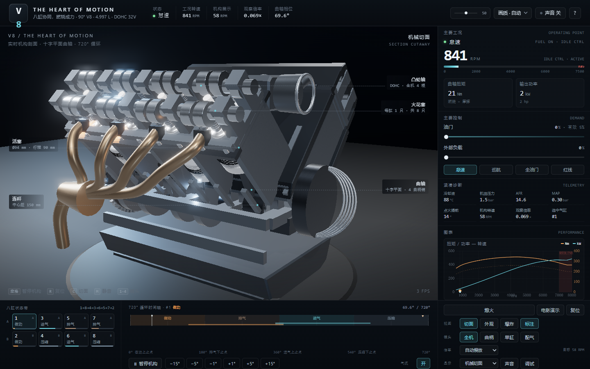

# V8 / THE HEART OF MOTION

**八缸协同，燃烧成力。**

一个在浏览器里运行的实时 3D V8 发动机实验室：90° V8、十字平面曲轴、DOHC 32 气门、4.997 L。
机械运动来自同一套曲柄连杆运动学，工况来自一套简化的扭矩—阻力微分方程；剖切、爆炸、单缸放大、720° 循环时间轴、工况仪表和程序音效都是可交互的。

▶ **在线体验：** https://kkk111-222.github.io/v8-heart-of-motion/



---

## 特性

- **真实运动学**：`s = r·cosη + √(l² − r²sin²η)`，`η = θ + β − α`；8 个活塞、8 根连杆、4 个共享曲柄销、十字平面曲轴；连杆永远连接「曲柄销 ↔ 活塞销」两个真实端点，长度恒为 150 mm
- **配气正时**：凸轮外形与气门升程由同一条 sin² 包络生成，凸轮转半圈、气门跟着动；排气 140°–370°、进气 350°–580°，20° 重叠
- **点火顺序** 1→8→4→3→6→5→7→2，720° 循环内每缸点火一次；燃烧只出现在做功早期，不会烧满整个冲程
- **两种时间**：工况时间（油门、负载、转速、温度）与展示时间（可自动慢放 / 手动倍率 / 真实 1×）解耦，切倍率不跳角度
- **三种结构视图**：机械切面 / 外观 / 分层爆炸（保存基准变换，退出精确归位）
- **四个镜头预设**：全机 / 曲柄 / 单缸 / 配气，0.9–1.4 s 平滑过渡
- **仪表**：转速条与红线区、扭矩/功率曲线（当前工作点随工况移动）、选中缸 P/V 图、八缸状态带、720° 时间轴（可拖动、可步进）
- **工程标注**：真实 3D 锚点 + 引线，随相机更新
- **程序音效**：Web Audio 合成，跟随工况转速，默认静音
- **电影演示**：约 24 秒编排，任何用户操作立即接管

## 运行

单文件，无需构建：

```bash
# 方式一：直接双击 index.html（需要联网加载 Three.js）
# 方式二：本地服务器
python -m http.server 8080
# 然后访问 http://127.0.0.1:8080/
```

需要支持 **WebGL2** 的浏览器（Chrome / Edge / Safari 新版）。Three.js 通过 import map 固定 `three@0.169.0`，核心库与附加模块版本一致。

## 操作

| 操作 | 说明 |
|---|---|
| 左键拖动 / 滚轮 / 右键 | 旋转 / 缩放 / 平移 |
| 点击活塞、连杆、气门 | 选中该缸并切到单缸视角 |
| `空格` | 机构暂停 / 继续 |
| `R` / `C` / `E` | 复位视角 / 切面↔外观 / 爆炸图 |
| `M` | 声音开关 |
| `1`–`4` | 四个镜头预设 |
| `←` `→` | 暂停状态下 1° 步进（`Shift` 为 15°） |

## 数据校验

`verify-kinematics.js` 用独立脚本复算运动学与配气（不依赖浏览器）：

```bash
node verify-kinematics.js
```

```
行程实测        90.000000 mm
连杆长度误差    5.68e-14
8 缸上止点     全部落在各自 Fi
点火顺序        1,8,4,3,6,5,7,2
排量            4.9966 L
压缩比          11.5
```

## 教学简化（如实说明）

1. 缸盖内部为**敞开的气门机构**呈现（便于观察凸轮/弹簧/气门），不是可铸造实体；
2. 压缩比 11.5:1 是给定参数，未由建模容积反算；
3. 缸压、P-V、AFR、MAP、温度、油压均为简化模型，界面上标注「教学示意」；
4. 进排气为象征性粒子，不是流体仿真；
5. 音效为程序合成，跟随工况转速，慢放时不宣称与每次火花逐次同步。

## 目录

```
index.html              交付物（单文件，可直接运行）
说明.md                 中文使用说明
src/ + build.ps1        源码分片与拼接脚本（修改时用，运行不需要）
verify-kinematics.js    独立运动学校验
docs/                   截图
```

## 许可

未指定 License。如需开源授权，可自行添加 MIT 等许可文件。
